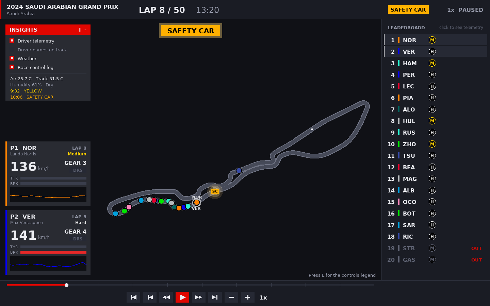

# F1 Race Replay

Replay any Formula 1 race since 2018: every car on a drawn track, live
leaderboard with tyres, safety car, retirements, playback controls and driver
telemetry. One Python data pipeline (FastF1 + numpy) feeds two viewers: an
Arcade desktop app and a Next.js web app streamed over WebSockets.



**Status:** data pipeline and desktop viewer done (phases 1–3 of 8). See [docs/PROGRESS.md](docs/PROGRESS.md).

## Quick start

```bash
python3 -m venv venv && source venv/bin/activate
pip install -r requirements.txt
python main.py list-rounds --year 2024
python main.py prepare --year 2024 --round 2
python main.py desktop --year 2024 --round 2
python -m pytest
```

## Learning guide

The project doubles as a course: see [docs/README.md](docs/README.md).
