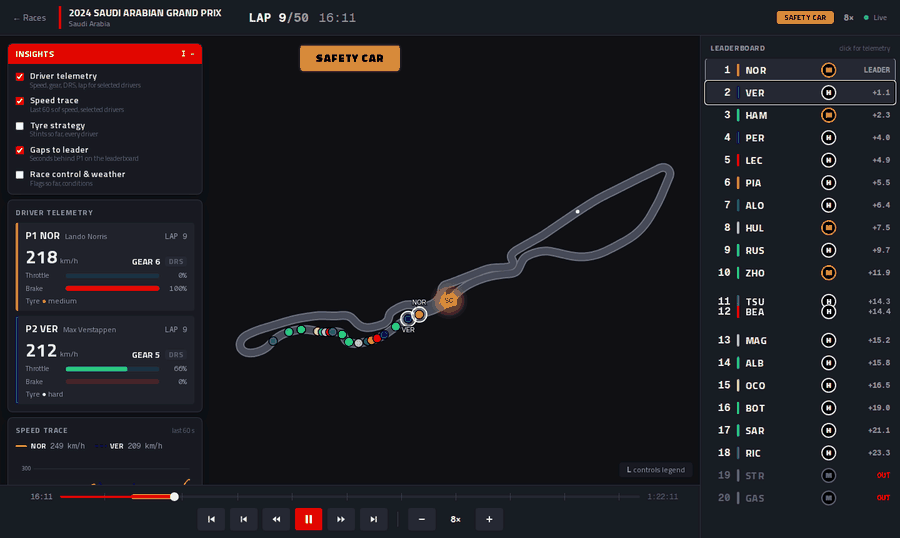
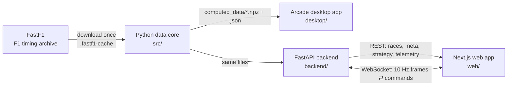

# F1 Race Replay

**Replay any Formula 1 race since 2018: every car on the track, a live leaderboard, the safety car, retirements, and per-driver telemetry. Streamed to the browser like a live feed.**



One Python data pipeline (FastF1 + numpy) feeds **two clients**: a Next.js web app, streamed over WebSockets by a FastAPI server, and an Arcade desktop app.

## Features

| | |
|---|---|
| **Race replay** | All 20 cars on a rendered track at 60 fps, interpolated from a 10 Hz stream |
| **Safety car** | Leaves the pit lane, leads the field, returns to the pits, with a pulsing glow and fade transitions |
| **Leaderboard** | Live positions, tyre compounds, gaps to the leader, DRS, +N LAP; rows slide on overtakes |
| **Driver status** | Retired drivers are marked **OUT** and drop to the bottom |
| **Lap & time** | Current lap / total and race clock; track status (green, yellow, SC, VSC, red) |
| **Controls** | Play/pause, ±5 s, ±1 lap, 0.25×–32×, a scrubbable timeline with safety-car periods marked, plus keyboard shortcuts |
| **Legend** | On-screen explanation of every control and colour |
| **Insights menu** | Opens with the replay: driver telemetry, speed trace, tyre strategy, gaps, race control & weather |
| **Driver telemetry** | Speed, gear, DRS, lap, throttle and brake for up to two selected drivers |

| Web app | Tyre strategy (spoiler-free) | Desktop app |
|---|---|---|
|  |  |  |

## Engineering highlights

- **Columnar data pipeline:** parallel per-driver extraction, resampled onto a shared 10 Hz clock. Bahrain 2024 went from a **322 MB** row-oriented pickle to a **20 MB** compressed `.npz` (≈16× smaller).
- **Validated against reality:** start order = grid, finish order = official classification, lapped drivers = official results (Bahrain, Saudi Arabia, Australia 2024). Two ranking biases were found and fixed on the way.
- **Modelling missing data:** FastF1 has no safety-car position or pit-lane coordinates. The pit lane is derived from real pit events, and the safety car is a state machine (deploy → lead → return).
- **Live-data protocol:** the server owns the playback clock. Frames are compact (1.5 KB, 2.3× smaller than naive JSON), sent at a fixed 10 Hz at any playback speed, and silent when paused. Commands are acked, so stale in-flight frames are dropped after a seek.
- **Resilient client:** 60 fps entity interpolation, and reconnects with exponential backoff that resume at the same race time (tested by killing the server mid-replay).
- **Gaps measured like F1 timing:** time at the same place on track, by inverting the leader's progress curve.
- **Tested end to end:** 67 Python tests, 22 web unit tests, 15 Playwright browser tests (stable over repeated runs), and CI on every push.

## Architecture



| Layer | Stack |
|-------|-------|
| Data | Python 3.12, FastF1, pandas, numpy, multiprocessing |
| Desktop | Arcade 3 (pyglet / OpenGL) |
| API | FastAPI, Uvicorn, WebSockets, Pydantic |
| Web | Next.js 16 (App Router), React 19, TypeScript, Tailwind CSS 4, Zustand, Motion, HTML Canvas |
| Tests & CI | pytest, Vitest, Playwright, GitHub Actions |

## Quick start

```bash
# Python 3.12 + Node 20
python3 -m venv venv && source venv/bin/activate
pip install -r requirements.txt

python main.py prepare --year 2024 --round 2      # download + process a race (~3 min the first time)
python main.py desktop --year 2024 --round 2      # desktop app

python main.py serve                              # API on http://127.0.0.1:8000  (docs: /docs)
cd web && npm install && npm run dev              # web app on http://localhost:3000
```

From the web app you can prepare more races (any season since 2018) with a progress bar.

## Tests

```bash
python -m pytest                        # Python unit tests
cd web && npm test && npm run typecheck && npm run lint

# browser tests (need both servers running and 2024 round 2 prepared)
python -m venv .venv-e2e && .venv-e2e/bin/pip install -r e2e/requirements.txt
.venv-e2e/bin/python -m playwright install chromium
.venv-e2e/bin/python -m pytest e2e
```

## Deploying

The web app goes on **Vercel**. The API needs a long-running server for its WebSockets (Render, Fly.io, Railway), and the included `Dockerfile` bakes the demo races into the image. Step-by-step guide: [docs/14-deploy-and-resume.md](docs/14-deploy-and-resume.md).

## Project layout

```
src/        data core: pipeline, storage, safety car, snapshots, playback clock
backend/    FastAPI app, background prepare jobs, WebSocket replay stream
desktop/    Arcade desktop viewer
web/        Next.js app (app/, components/, lib/)
tests/      Python unit tests        e2e/  browser tests
docs/       learning guide (15 chapters)
```

## Learning guide

This project was built as a course: [docs/README.md](docs/README.md) walks through every part from first principles (data pipelines, columnar storage, WebSockets, React, canvas animation, testing), with the real numbers and bugs from building it.

## Credits

- Data: [FastF1](https://github.com/theOehrly/Fast-F1), which reads Formula 1's public timing archive.
- The original per-driver telemetry extraction in `src/f1_data.py` was adapted from the open-source *f1-race-replay* project, then rebuilt (see the git history and `docs/04-data-pipeline.md`).
- This is a fan project, not affiliated with or endorsed by Formula 1, the FIA or any team. F1 and related marks belong to their owners.
