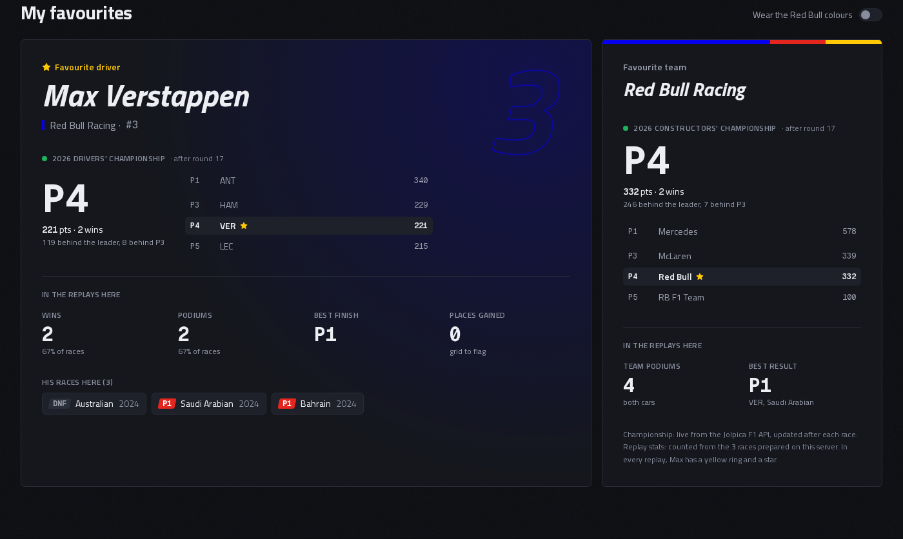
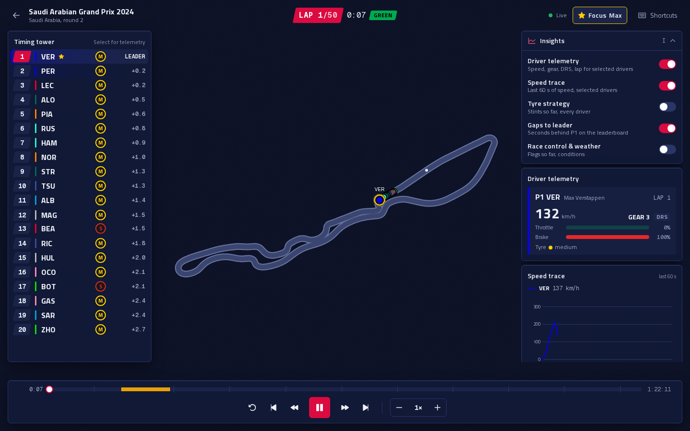
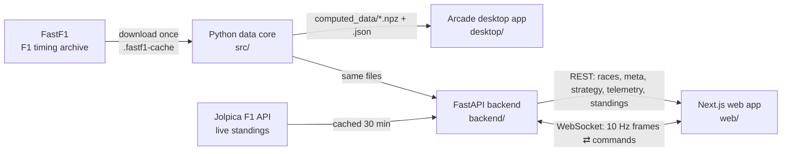

# F1 Race Replay

**Replay any Formula 1 race since 2018: every car on the track, a live leaderboard, the safety car, retirements, and per-driver telemetry. Streamed to the browser like a live feed.**


One Python data pipeline (FastF1 + numpy) feeds **two clients**: a Next.js web app, streamed over WebSockets by a FastAPI server, and an Arcade desktop app.

## Features

| | |
|---|---|
| **Race replay** | All 20 cars on a rendered track at 60 fps, interpolated from a 10 Hz stream |
| **Safety car** | Leaves the pit lane, leads the field, returns to the pits, with a pulsing glow and fade transitions |
| **Leaderboard** | Live positions, tyre compounds, gaps to the leader, DRS, +N LAP; rows slide on overtakes |
| **Driver status** | Retired drivers are marked **OUT** and drop to the bottom |
| **Lap & time** | Current lap / total and race clock; track status (green, yellow, SC, VSC, red) |
| **Controls** | Play/pause, ±5 s, ±1 lap, 0.25×–32×, a scrubbable timeline with safety-car periods marked, plus keyboard shortcuts |
| **Legend** | On-screen explanation of every control and colour |
| **Insights menu** | Opens with the replay: driver telemetry, speed trace, tyre strategy, gaps, race control & weather |
| **Light & dark, phone to desktop** | Follows the system theme (both checked to WCAG AA); a column layout with tabs on phones |
| **Driver telemetry** | Speed, gear, DRS, lap, throttle and brake for up to two selected drivers |
| **Favourite driver spotlight** | Max Verstappen gets a yellow ring and an always-on tag on the track, a ★ on his timing-tower row, and Red Bull rows are tinted in team colour. **Focus Max** (or the <kbd>M</kbd> key) selects him for telemetry |
| **Live championship standings** | The home page shows where Max and Red Bull stand in the current season right now: position, points, wins, gaps and a mini ladder, refreshed after every race |
| **Favourites card** | Max's record across the replays on the server: wins, podiums, best finish, places gained, with one click into each race |
| **Red Bull theme** | An optional navy and Red Bull red colour theme, remembered across visits, contrast-checked in light and dark |

| Race picker | Replay, light theme | Phone |
|---|---|---|
|  |  |  |

| Tyre strategy (spoiler-free) | Desktop app (Arcade) |
|---|---|
|  |  |

| Favourites with live 2026 standings | Max spotlight + Red Bull theme |
|---|---|
|  |  |

**Make it yours:** the favourite driver and team are two lines in [`web/lib/favourites.ts`](web/lib/favourites.ts). Change `VER` / `Red Bull Racing` to, say, `LEC` / `Ferrari`, and the spotlight, card and standings all follow.

## Engineering highlights

- **Columnar data pipeline:** parallel per-driver extraction, resampled onto a shared 10 Hz clock. Bahrain 2024 went from a **322 MB** row-oriented pickle to a **20 MB** compressed `.npz` (≈16× smaller).
- **Validated against reality:** start order = grid, finish order = official classification, lapped drivers = official results (Bahrain, Saudi Arabia, Australia 2024). Two ranking biases were found and fixed on the way.
- **Modelling missing data:** FastF1 has no safety-car position or pit-lane coordinates. The pit lane is derived from real pit events, and the safety car is a state machine (deploy → lead → return).
- **Live-data protocol:** the server owns the playback clock. Frames are compact (1.5 KB, 2.3× smaller than naive JSON), sent at a fixed 10 Hz at any playback speed, and silent when paused. Commands are acked, so stale in-flight frames are dropped after a seek.
- **Resilient client:** 60 fps entity interpolation, and reconnects with exponential backoff that resume at the same race time (tested by killing the server mid-replay).
- **Gaps measured like F1 timing:** time at the same place on track, by inverting the leader's progress curve.
- **Two data sources, failing soft:** race replays come from FastF1; live standings come from the [Jolpica F1 API](https://github.com/jolpica/jolpica-f1) (the Ergast successor). The backend caches them for 30 minutes, serves the last good copy when Jolpica is down, and backs off before retrying. If there's nothing to show, the card says so and the rest of the page keeps working.
- **Themes as layers:** light/dark and the Red Bull theme are all CSS variables. A tiny script in `<head>` applies the saved theme before the first paint, so it never flashes.
- **Tested end to end:** 72 Python tests, 31 web unit tests, 24 Playwright browser tests run in both colour schemes (48 runs, including live WCAG contrast checks and a simulated standings outage), and CI on every push.
- **Design system:** CSS-variable tokens for light and dark, contrast verified in the browser, one shape rule, and a performance-first choice measured on the live canvas (no backdrop blur: 60 vs ~27 fps).

## Architecture



| Layer | Stack |
|-------|-------|
| Data | Python 3.12, FastF1, pandas, numpy, multiprocessing, Jolpica F1 API (standings) |
| Desktop | Arcade 3 (pyglet / OpenGL) |
| API | FastAPI, Uvicorn, WebSockets, Pydantic |
| Web | Next.js 16 (App Router), React 19, TypeScript, Tailwind CSS 4, Zustand, Motion, HTML Canvas |
| Tests & CI | pytest, Vitest, Playwright, GitHub Actions |

## Quick start

```bash
# Python 3.12 + Node 20
python3 -m venv venv && source venv/bin/activate
pip install -r requirements.txt

python main.py prepare --year 2024 --round 2      # download + process a race (~3 min the first time)
python main.py desktop --year 2024 --round 2      # desktop app

python main.py serve                              # API on http://127.0.0.1:8000  (docs: /docs)
cd web && npm install && npm run dev              # web app on http://localhost:3000
```

From the web app you can prepare more races (any season since 2018) with a progress bar.

## Tests

```bash
python -m pytest                        # Python unit tests
cd web && npm test && npm run typecheck && npm run lint

# browser tests (need both servers running and 2024 round 2 prepared)
python -m venv .venv-e2e && .venv-e2e/bin/pip install -r e2e/requirements.txt
.venv-e2e/bin/python -m playwright install chromium
.venv-e2e/bin/python -m pytest e2e
```

## Deploying

The web app goes on **Vercel**. The API needs a long-running server for its WebSockets (Render, Fly.io, Railway), and the included `Dockerfile` bakes the demo races into the image. Step-by-step guide: [docs/14-deploy-and-resume.md](docs/14-deploy-and-resume.md).

## Project layout

```
src/        data core: pipeline, storage, safety car, snapshots, playback clock
backend/    FastAPI app, background prepare jobs, WebSocket replay stream
desktop/    Arcade desktop viewer
web/        Next.js app (app/, components/, lib/)
tests/      Python unit tests        e2e/  browser tests
docs/       learning guide (15 chapters; favourites + live standings in chapter 12)
```

## What I learned

I built this project to learn every layer, so here's what each part taught me. The full write-ups, with the real numbers and bugs, are in the [learning guide](docs/README.md).

| Area | What I learned |
|---|---|
| **Data engineering** | Turning messy telemetry into clean arrays: resampling onto one clock, columnar storage (322 MB → 20 MB), parallel processing, and checking results against official classifications |
| **Modelling** | Filling gaps in the data honestly: a safety-car state machine, a pit lane derived from real pit events, gaps measured the way F1 timing does |
| **Backend** | REST vs WebSockets, a server-owned clock, compact frame protocols, background jobs, CORS (including a real "can't reach the backend" bug caused by `localhost` vs `127.0.0.1`) |
| **Third-party APIs** | Calling an external API from the backend rather than the browser, TTL caching, stale fallback with retry back-off, and matching teams by id because two sources name them differently ("Red Bull Racing" vs `red_bull`) |
| **Frontend** | React state vs a canvas render loop, entity interpolation at 60 fps, reconnects with backoff, server vs client components in Next.js 16 (a client-only hook imported into the layout caused a 500 error) |
| **Design** | Design tokens, WCAG contrast checks for every colour pair, theme layers with CSS variables, avoiding a flash of the wrong theme, measuring rendering cost (no backdrop blur: 60 vs ~27 fps) |
| **Product thinking** | A single source of truth for "my favourites", honest statistics (a retirement isn't a P19 finish), labelling live data apart from replay data, degrading gracefully when a source is down |
| **Testing** | Unit tests with fake clocks and fake network calls, browser tests with mocked API routes so they don't break when the real championship changes, and scoping tests so new features don't break old assertions |
| **Git & GitHub** | Merging unrelated histories while keeping my own tree (`git merge -s ours`), personal access token scopes (`workflow` is needed to push CI files), and rewriting commit messages safely with a backup tag |

## Learning guide

This project was built as a course: [docs/README.md](docs/README.md) walks through every part from first principles (data pipelines, columnar storage, WebSockets, React, canvas animation, testing), with the real numbers and bugs from building it.

## Credits

- Data: [FastF1](https://github.com/theOehrly/Fast-F1), which reads Formula 1's public timing archive.
- The original per-driver telemetry extraction in `src/f1_data.py` was adapted from the open-source *f1-race-replay* project, then rebuilt (see the git history and `docs/04-data-pipeline.md`).
- This is a fan project, not affiliated with or endorsed by Formula 1, the FIA or any team. F1 and related marks belong to their owners.
