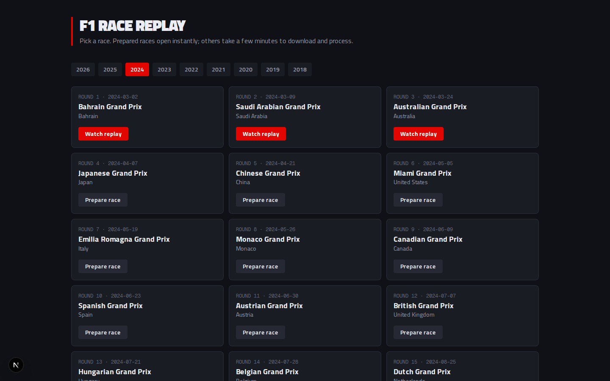

# 10 — Next.js, React and TypeScript



```bash
python main.py serve          # terminal 1: the API
cd web && npm run dev         # terminal 2: http://localhost:3000
```

## What we built (phase 5)

- **Race picker** (`/`): choose a season, see every race with its status,
  prepare a race with a live progress bar, and open ready races.
- **Replay page** (`/replay/2024/2`): loads the race, opens the WebSocket
  stream, and draws the cars moving on the track at 60 fps. It has a play/pause
  button, lap and clock, and a connection badge.
- Automatic **reconnect** that resumes where you were.

## JavaScript and TypeScript in five minutes

TypeScript is JavaScript plus **types**. The browser runs JavaScript; the
TypeScript compiler (`npm run typecheck`) checks the types first and catches
mistakes before you run anything.

```ts
// a type describes the shape of an object
interface DriverState {
  code: string;
  position: number;
  tyre: "SOFT" | "MEDIUM" | "HARD" | "INTERMEDIATE" | "WET" | "UNKNOWN"; // only these strings
  out: boolean;
}

const leader: DriverState = { code: "VER", position: 1, tyre: "SOFT", out: false };
leader.position = "first";   // ✗ compile error: string isn't a number
```

All the backend's message shapes live in `web/lib/types.ts`. If the backend
renames a field, the compiler points at every place in the frontend that
breaks. Compare Python, where you'd find out at runtime.

Other JS ideas used everywhere here:

| Idea | Example |
|------|---------|
| Arrow functions | `(a, b) => a + b` |
| Destructuring | `const { year, round } = await params` |
| Spread | `{ ...buffer, latest: frame }` copies `buffer` with one field changed |
| `async` / `await` | `const meta = await api.meta(2024, 2)`: wait for a Promise |
| Optional chaining | `buffer.latest?.t ?? 0`: `0` if `latest` is null |

## React: components, props, state, effects

A **component** is a function that returns what to show (JSX, HTML-like syntax):

```tsx
function ClockReadout({ totalLaps }: { totalLaps: number }) {   // props in
  const lap = useReplayStore((s) => s.buffer.latest?.lap ?? 1);   // state
  return <p>LAP {lap}/{totalLaps}</p>;                            // UI out
}
```

- **Props** are inputs from the parent (`totalLaps`).
- **State** is data that changes over time. When it changes, React re-runs the
  function and updates the page. `useState` holds local state, as in
  `RacePicker`'s selected `year`.
- **Effects** (`useEffect`) do things *outside* rendering: fetch data, open a
  WebSocket, start a timer. They return a **cleanup** function, which React
  calls when the component goes away or the inputs change:

```tsx
useEffect(() => {
  if (!meta) return;
  connect(year, round);          // open the stream...
  return () => disconnect();     // ...and close it when we leave the page
}, [meta, year, round]);         // re-run only when these change
```

Forgetting cleanup is the #1 React bug with live data: leave the page and the
socket keeps streaming in the background.

### The "cancelled" pattern

```tsx
useEffect(() => {
  let cancelled = false;
  api.events(year).then((data) => { if (!cancelled) setEvents(data); });
  return () => { cancelled = true; };
}, [year]);
```

Click 2023, then quickly 2022. The 2023 response might arrive *after* the 2022
one and overwrite it. The flag makes the stale response do nothing. This is a
classic **race condition**.

## Zustand: one store for live data

`web/lib/replayStore.ts` holds everything about the current replay: connection
state, the last two frames, and a `send()` function. Components pick only the
slice they need:

```tsx
const playing = useReplayStore((s) => s.buffer.latest?.playing ?? false);
```

That component re-renders only when `playing` changes, not on each of the 10
frames per second. `ClockReadout` subscribes to `Math.floor(t)`, so it
re-renders once per second.

The canvas doesn't subscribe at all. It calls `useReplayStore.getState()`
inside its own animation loop (chapter 11). **React for structure, a plain
loop for the fast stuff.**

## Next.js App Router

**Files are routes:**

| File | URL |
|------|-----|
| `app/page.tsx` | `/` |
| `app/replay/[year]/[round]/page.tsx` | `/replay/2024/2` (`[year]` is a dynamic segment) |
| `app/layout.tsx` | Wraps every page (fonts, `<html>`, `<body>`) |

**Server vs client components.** By default a component runs on the
**server** and sends finished HTML. Anything that needs the browser (state,
effects, WebSockets, canvas, click handlers) must start with `"use client"`.
Our pages are thin server components that render client components.

### Next.js 16 specifics we ran into

We followed the docs bundled with the installed version
(`web/node_modules/next/dist/docs/`, as `web/AGENTS.md` says), not older
tutorials:

- **`params` is a Promise.** `const { year, round } = await params`. The
  `PageProps<"/replay/[year]/[round]">` type is generated by Next
  (`npx next typegen`); until it was generated, TypeScript rejected the route.
- **Cache Components are on**, so reading `params` is "runtime data" and must
  happen inside `<Suspense>`. The build output shows the result: `/` is
  **Static**, and `/replay/[year]/[round]` is **Partial Prerender** (a static
  shell, with the race-specific part streamed in).
- **Turbopack** is the default bundler, so no flags are needed.
- `NEXT_PUBLIC_API_URL` is **inlined at build time**. Changing it later
  requires a rebuild.

## Talking to the backend

- `web/lib/api.ts`: a typed `fetch` wrapper. It turns "server unreachable"
  into a helpful message ("Is `python main.py serve` running?") and turns
  HTTP errors into an `ApiError` with the status code. The replay page uses
  the 404 to say "this race hasn't been prepared yet".
- **Polling** for preparation progress (`RacePicker`): once a second, only
  while a race is preparing.
- **Streaming** for the replay: `web/lib/replaySocket.ts` (chapter 11).

## Exercises

1. Add a "Ready to watch" row at the top of the home page using `api.races()`.
2. Make the selected season part of the URL (`/?year=2023`) so it survives a
   refresh. (Hint: `searchParams`; remember the `<Suspense>` rule.)
3. Break a type on purpose (rename `position` in `types.ts`) and run
   `npm run typecheck`. How many places does it find?

## Interview angle

"The frontend is Next.js 16 with the App Router and TypeScript. Backend
message shapes are typed in one module, so protocol changes become compile
errors. Live state lives in a Zustand store with selector subscriptions, so
React only re-renders what changed, while the canvas reads the store directly
in its animation loop. I followed the version-matched framework docs, which
mattered because Next 16 changed params and caching behaviour."
