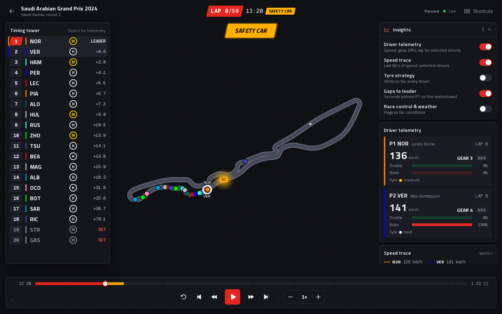
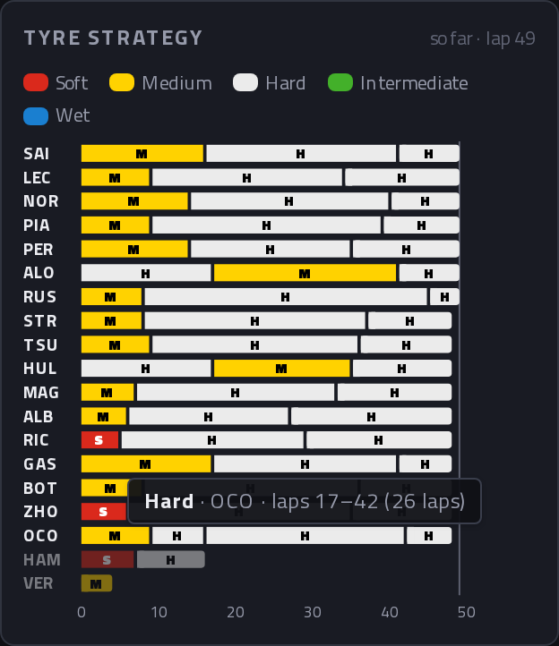
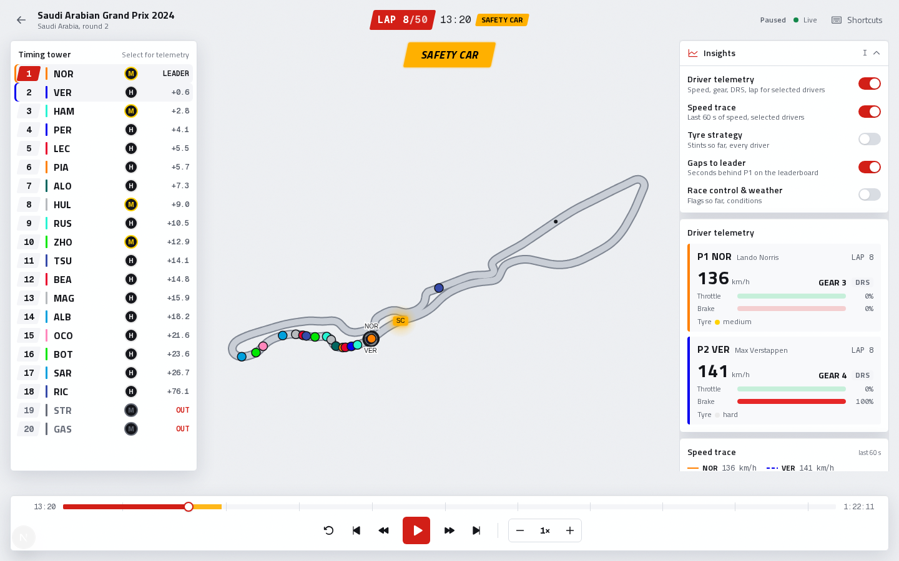
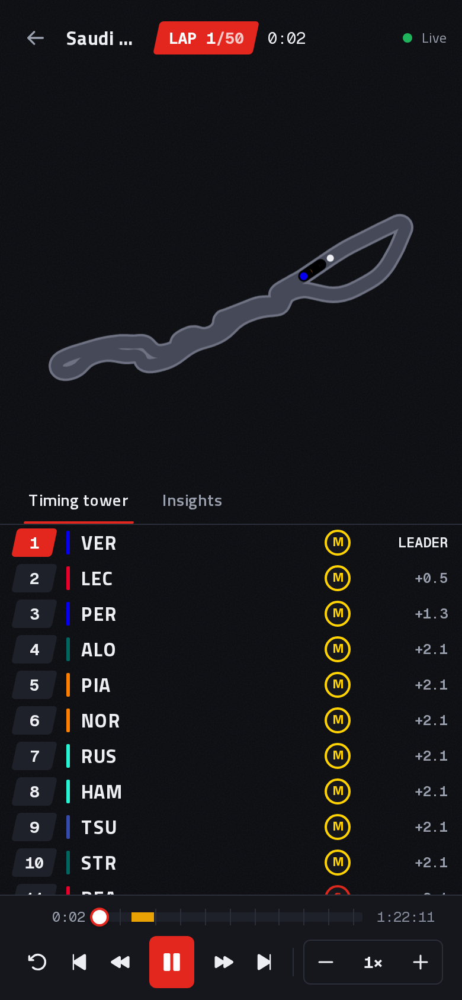

# 12 — The replay HUD (heads-up display)



Phase 6 turned the bare track into a full replay screen; phase 7 added the
Insights menu and its analysis tools (second half of this chapter).

## Layout: CSS grid with named areas

```
┌──────────────────── top ────────────────────┐
│ ← Races │ 2024 SAUDI… │ LAP 8/50 13:20 │ SC 1× ● │
├──────────── track ────────────┬──── side ───┤
│ canvas + banner + legend      │ leaderboard │
├──────────── bottom ───────────┤             │
│ timeline + buttons            │             │
└───────────────────────────────┴─────────────┘
```

`ReplayView.tsx` declares the areas once
(`[grid-template-areas:'top_top''track_side''bottom_side']`), and each
component places itself (`[grid-area:side]`). Moving a panel means editing one
string, not five components.

## Features and where they live

| Feature | Component | Notes |
|---------|-----------|-------|
| Lap & race time | `TopBar.tsx` → `RaceClock` | Subscribes to `lap` and `floor(t)`, so it re-renders once a second |
| Track status pill | `TopBar.tsx` → `StatusPill` | Colour from `lib/status.ts` |
| SC / VSC / red flag banner | `StatusBanner.tsx` | Slides in (motion `AnimatePresence`), pulses with a CSS `box-shadow` keyframe |
| Leaderboard | `Leaderboard.tsx` | Position, team colour, tyre badge, OUT / +N LAP / DRS; rows slide on overtakes |
| Driver OUT | `Leaderboard.tsx`, `TrackCanvas.tsx` | Row greyed with red OUT, sorted last; car no longer drawn |
| Controls | `ControlBar.tsx` | Restart, ±lap, ±5 s, play/pause, slower/faster with speed readout |
| Timeline | `ControlBar.tsx` → `Timeline` | Click or drag to jump; lap ticks every 5 laps; SC/VSC/red flag bands |
| Keyboard shortcuts | `useKeyboardShortcuts.ts` + `lib/shortcuts.ts` | Same keys as the desktop app |
| Legend | `Legend.tsx` | Generated from the same `SHORTCUTS` list the keyboard uses |
| Selecting drivers | `lib/uiStore.ts` | Click a leaderboard row **or a car on the map**; up to 2; Esc clears |

## Design decisions worth explaining

**One source of truth for shortcuts.** `lib/shortcuts.ts` holds the mapping
(a pure function, unit-tested) *and* the list the legend displays. The legend
can't drift out of date with what the keys actually do.

**The timeline sends one seek per drag.** While you drag, only the knob moves
(local React state). The seek goes to the server once, on release. Verified in
the browser test by counting WebSocket messages: exactly 1 seek for a 5-step
drag.

**Safety car periods on the timeline.** `neutralisedPeriods()` turns the list
of status changes into coloured bands (SC, red flag, and VSC with VSC-ending
merged in), so you can see and jump straight to the action.

**Animate overtakes, snap after jumps.** Leaderboard rows use motion's
`layout` animation (FLIP: measure the old and new positions, then animate the
difference with a transform). But after a seek, the whole order changes at
once and 20 rows flying around is noise. Measured with the browser: 0.1 s after
a lap jump, rows overlapped (gaps from −26 px to 98 px). With "snap after
jumps" they're evenly spaced (36 px) immediately, while during normal play rows
were caught mid-slide in 149 of 233 samples. The canvas follows the same rule
(chapter 11).

**Space on a focused button.** After clicking Play, the button has keyboard
focus. Pressing Space would then fire *both* our shortcut *and* the browser's
"click the focused button": a double toggle that does nothing. The keyboard
hook calls `preventDefault()`, and the browser test checks that exactly one
toggle is sent.

**Don't steal browser shortcuts.** Ctrl/Cmd+key combos are ignored (Ctrl+R
reloads, Cmd+L focuses the address bar), and so are keys typed into form
fields.

**Accessibility basics.** Buttons have `aria-label`s and tooltips with their
shortcut. The timeline is a `role="slider"` with a readable `aria-valuetext`
("13:20"). The connection and status changes are announced with
`aria-live`. Animations switch off when the OS asks for reduced motion
(`MotionConfig reducedMotion="user"`, plus a CSS media query for the pulse).

## A data bug the UI exposed: "+1 LAP" for everyone

The first HUD screenshot, right after the leader started lap 2, showed
**every other driver as "+1 LAP"**. The rule was "lapped = on a lower lap
number than the leader", which is true for everyone for a few seconds each
time the leader crosses the line.

The fix (`src/snapshot.py`, so the desktop app gets it too) compares
**progress** instead: lapped means at least one full lap behind. That
revealed a second, subtler issue. At the flag the six officially lapped
drivers in Saudi Arabia measured **0.996–0.9998** laps behind, not 1.0,
because each lap's last telemetry sample lands a few metres before the line.
A tolerance of 0.01 laps (~50 m) absorbs that.

Checked against the official classification:

| Race | Lapped at the flag (ours) | Official "Lapped" |
|------|---------------------------|-------------------|
| Bahrain 2024 | 10 drivers | same 10 |
| Saudi Arabia 2024 | 6 drivers | same 6 |
| Australia 2024 | 7 drivers | same 7 |

*Lesson: a UI is a test of the data. Look at screenshots of real moments,
not just green unit tests.*

## Testing

- `web/lib/hud.test.ts`: shortcut mapping (including ignoring Ctrl+R),
  timeline bands and lap ticks, max-two selection.
- `tests/test_snapshot.py`: "lower lap number is not lapped" and "exactly
  one lap down despite the measurement gap".
- Browser test (Playwright, 16 checks): every shortcut, legend open/close,
  Space on a focused button, one seek per drag, the SC banner, OUT rows at
  the bottom, two-driver selection, Esc, and clicking a car on the canvas.
  The first version used fixed `sleep(0.4)` waits and failed once in 6 runs.
  Replacing them with "poll until the condition holds" made it pass 9 runs out
  of 9.

## Phase 7: the Insights menu


A floating menu on the left of the track **opens automatically with every
replay** (`I` or its header toggles it). Each tool is a checkbox; enabled
tools appear as cards below it, and the track is re-fitted into the space
beside the column (`fitTrack(..., insetLeft)`), so nothing hides the cars.

| Tool | Component | Data source |
|------|-----------|-------------|
| Driver telemetry | `TelemetryPanel.tsx` | Live frames: speed, gear, DRS, lap, tyre, throttle/brake meters |
| Speed trace | `SpeedTrace.tsx` | `GET .../telemetry/{code}`: last 60 s, refetched once per race-second |
| Tyre strategy | `TyreStrategy.tsx` | `GET .../strategy`: stints, shown only up to the current lap |
| Gaps to leader | `Leaderboard.tsx` | `gap` field in every frame |
| Race control & weather | `RaceControl.tsx` | Status changes so far + weather in frames |

### Gap to leader: measured the way F1 does it

A gap isn't a distance, it's **time at the same place**: "how many seconds
ago was the leader where this car is now?" The backend keeps the leader's
progress over time (`RaceData.leader_progress`, made non-decreasing with
`np.maximum.accumulate`) and inverts it with `np.interp`:

```python
passed_at = np.interp(driver_progress, race.leader_progress, race.arrays["t"])
gap = t - passed_at
```

Saudi Arabia 2024 under the safety car: NOR leads, VER +2.1 s, HAM +2.8 s.
The field is bunched, exactly as expected.

### Tyre stints: use the right column



We first rebuilt stints from the per-frame tyre colour. That can't see a pit
stop onto the *same* compound. FastF1's laps table has a `Stint` number, so
the pipeline now saves real stints in `meta.json` (`src/strategy.py`). In
Australia 2024, **15 drivers** made Hard → Hard stops that the colour-only
version would have merged into one long stint. OCO even ran three Hard
stints. The chart shows each stop as a 2 px gap between bars.

**No spoilers:** the full strategy is known in advance, so `stintsSoFar()`
drops stints that haven't started and cuts the current one at the driver's
current lap.

### Chart design (and the palette check)

Both charts follow the data-visualisation rules we adopted:

- **One y-axis.** The speed trace shows speed only; throttle and brake live
  in the telemetry card. Two different scales on one chart mislead.
- **Thin marks, quiet grid:** 2 px lines, 10 px bars (max 24 px), solid
  hairline gridlines, and a 2 px surface gap between stints.
- **Identity never by colour alone.** Teammates share a team colour (NOR and
  PIA are both McLaren orange), so the second selected driver's line is
  **dashed**, and there's a legend with line keys.
- **Text in text colours.** Values and names are white/grey; the colour sits
  on the line or bar next to them.
- **A tooltip that enhances, never gates.** The crosshair snaps to the nearest
  sample and lists *both* drivers (value first, name second); the same
  numbers are in the legend and the telemetry cards.

We ran the Pirelli compound colours through a palette validator on our dark
panel. It flagged white (hard) and yellow (medium) as outside the ideal
lightness band, soft vs intermediate as close for deuteranopes (ΔE 8.0), and
wet blue at 2.87:1 contrast. Repainting tyres would confuse every F1 fan, so
we kept the convention and added **secondary encoding**: a letter in every
segment that fits one, a legend and a tooltip. Wet moved one step lighter
(`#1a7fd0`, passes 3:1). The letter colour is chosen by measured WCAG contrast,
which picks **black** on wet blue (4.99:1 vs 4.21:1 for white), contrary to
intuition.

### Bugs found while testing phase 7

- **Ticking an Insights checkbox disabled every keyboard shortcut.** The
  checkbox kept focus, and the shortcut hook ignored keys on *any* `<input>`.
  Now only text-entry fields block shortcuts (`isTypingTarget()`, unit-tested).
- **"(1 laps)"** in the stint tooltip, fixed with a tiny `lapCount()`.
- A React lint rule caught `setState` called synchronously inside an effect
  in the telemetry hook. The fix was to **derive** "loading" (`result.id !==
  wanted`) instead of storing it.

## Exercises

1. Show the interval to the car ahead (not just the gap to the leader) on the
   leaderboard. Which existing value makes this a one-liner?
2. Show a small "PIT" tag when a car is in the pit lane. (Hint: the backend
   knows `PitInTime`/`PitOutTime` per lap.)
3. Make the leaderboard collapsible on narrow screens.

## Interview angle

"The HUD is a CSS-grid layout of small components, each subscribing to just
the slice of state it shows. Shortcuts are one tested pure function that also
generates the legend. The timeline sends a single seek per drag and shows
safety-car periods. I animate real overtakes but snap after seeks, measured in
the browser. And reviewing screenshots of real race moments surfaced a
lapped-car bug in the shared data layer, which I fixed and verified against
the official classification for three races."

## The redesign: "pit wall" design system


| Light theme | Phone |
|---|---|
|  |  |

After the features were done, the web app got a full visual overhaul, audited
and planned first in [REDESIGN_PLAN.md](REDESIGN_PLAN.md) (with the complete
pre-flight results). The ideas worth knowing:

**Design tokens.** Every colour is a CSS variable in `web/app/globals.css`
with a dark and a light value, switched by the visitor's system setting.
Components never use raw colours, so one file controls both themes. The
canvas can't read CSS, so `web/lib/theme.ts` reads the variables and redraws
the track when the system theme flips.

**Contrast is tested, not eyeballed.** Every text/background pair meets WCAG
AA (4.5:1) in both themes. Red needed two tokens: `--accent` for fills (white
text on red passes) and a lighter `--accent-ink` for red *text* on dark panels
(the fill red was only 3.89:1). `e2e/test_design.py` checks the colours the
browser actually uses.

**Type and shape.** Titillium Web, with 700 italic as the display style (the
forward lean of F1 graphics); Geist Mono with tabular figures for every
number. One shape rule: 6 px corners on panels and controls, **slanted chips**
(skewed -12°) for positions, the lap bug and flags, round tyre badges. Nothing
else.

**The race picker** is a landing page: the hero's visual is the product
itself, a live mini replay that starts 20 s before the race's first safety
car (read from its own flag history). The ready races are a bento drawn from
their real circuit outlines, and the calendar groups rounds by month.

**The replay** puts the track full-bleed with panels floating over it. The
canvas is told how much space each panel takes (`fitTrack` insets), so no car
ever hides under a panel. On phones it becomes a column with Tower / Insights
tabs.

### Bugs and lessons from the redesign

- **A blur that halved the frame rate.** Frosted-glass panels
  (`backdrop-filter: blur`) over a canvas that redraws 60 times a second
  meant re-blurring every frame: **60 → ~27 fps**, measured. The panels sit
  over empty space anyway, so they use a near-opaque surface instead, and a
  browser test makes sure nothing blurs the canvas.
- **A compiler quirk.** Given both `backdrop-filter` and
  `-webkit-backdrop-filter`, Lightning CSS (inside Tailwind) kept only the
  prefixed one, which Chrome ignores. Write the standard property and let the
  tool add prefixes.
- **A stale dev server.** Twice, `next dev` missed an edit to `globals.css`
  and kept serving old colours, so screenshots and tests looked fine for the
  wrong reason. The fix is restarting after changing that file. The lasting
  protection is a test that reads the *live* tokens.
- **Measure before trusting your eyes.** The scrolled tiles, the leaderboard
  rows and the stale colours were all confirmed by measuring (opacity,
  positions, computed styles), not by looking.

## Motion pass: animate less, but better

After the redesign, the motion went through an audit (`improve-animations`),
a search for missing motion (`find-animation-opportunities`) and a review. The
plans and results are in [`plans/`](../plans/README.md). The rules we followed:

- **Should it animate at all?** Keyboard-triggered UI (the shortcuts popover,
  the Insights collapse) stays instant. Data people read (gaps, speeds) never
  moves for style. Most proposed animations were *rejected*.
- **Strong curves, short durations.** One set of tokens
  (`--ease-out: cubic-bezier(0.23, 1, 0.32, 1)` in CSS, `EASE_OUT` in
  `lib/motion.ts`), UI under 300 ms, and exits faster than entrances.
- **Animate only `transform` and `opacity`.** The safety-car banner used to
  repaint a `box-shadow` every frame for minutes; now its glow is drawn once and
  only its opacity pulses. The progress bar grows with `scaleX`, not `width`.
- **Feedback everywhere it's expected.** Links that look like buttons now dip
  on press like real buttons.
- **Two additions, both earned:** the connection-lost banner eases in and
  out, and a race finishing preparation settles in as "Watch replay" instead
  of swapping silently.

Two bugs the review caught, by **measuring**, not by looking:

1. When one banner replaced another (VSC to VSC ENDING), both rendered side by
   side for a moment and jumped sideways. `AnimatePresence mode="wait"` fixed it.
2. Switching to compositor-friendly `transform` strings silently broke reduced
   motion, because Motion's setting only recognises its own shorthands. Even
   after fixing that in JavaScript, a test failed *sometimes*: the
   server-rendered first paint can't know the visitor's setting. A CSS rule
   (`[data-enter] { transform: none !important }` under
   `prefers-reduced-motion`) covers it from the first frame.

## Favourites: Max Verstappen and Red Bull Racing

The site now has an owner: one favourite driver and one favourite team, set
in two lines of [`web/lib/favourites.ts`](../web/lib/favourites.ts). Change
them and the whole site follows. They show up in three places:

| Feature | Where | What it does |
|---|---|---|
| Spotlight in replays | `TrackCanvas.tsx`, `Leaderboard.tsx`, `TopBar.tsx` | Max's car gets a yellow ring and an always-on name tag, and is drawn last so it's never hidden. His row has a star; both Red Bull rows are tinted in the team colour. **Focus Max** (or the **M** key) selects him, so telemetry and the speed trace show him straight away. |
| Favourites card | `components/home/FavouritesCard.tsx` | Wins, podiums, best finish, places gained and a chip per race (each chip opens that replay), plus team podiums. |
| Red Bull theme | `lib/teamTheme.ts`, `globals.css`, `TeamThemeToggle.tsx` | A switch in the nav (and on the card) turns the site navy with Red Bull red. Remembered across visits. |

### Concepts

- **One source of truth.** The driver code and team name live in one file.
  The canvas, leaderboard, shortcut and card all ask `isFavouriteDriver()`
  instead of each one hard-coding `"VER"`.
- **Honest numbers.** The stats come only from what the race metadata really
  holds (grid, final position, status), and only for the races prepared on
  this server. The card says so. A retirement is not a finish: Max retired
  in Australia 2024 and was classified 19th, which must not count as "P19".
- **A theme is just variables.** Light/dark already swaps CSS variables. The
  team theme is one more layer: `:root[data-team="redbull"] { --bg: … }`.
  That selector is more specific than `:root`, so it wins without
  `!important`. The canvas re-reads the colours when the attribute changes,
  using a `MutationObserver` (it can't use CSS).
- **No flash of the wrong theme.** React runs *after* the first paint, so a
  saved choice applied by React would flash the default colours first. A
  tiny script in `<head>` (in `app/layout.tsx`) reads localStorage and sets
  the attribute before anything is drawn. `suppressHydrationWarning` tells
  React this difference on `<html>` is expected.
- **Contrast, again.** Every new colour pair was checked to WCAG AA (4.5:1
  for text). Yellow text fails on white, so the star uses a darker amber in
  light mode (`--fav-ink`), while the ring on the track keeps bright yellow
  with a thin dark edge so it shows on both themes.
- **Background tint without losing hover.** The row tint is a
  `background-image` gradient, so the row's `background-color` (hover,
  selected) still shows underneath.

### Bugs found while building it

1. **A server component imported a client hook.** `app/layout.tsx` is a
   server component, and it imported `lib/teamTheme.ts`, which used
   `useSyncExternalStore`. The page went to a 500 error. Fix: keep that file
   free of React, and move the hook into the client component that uses it.
2. **The dev server missed new Tailwind colours.** After adding `--color-fav`
   to `@theme`, `next dev` kept serving old CSS without `text-fav-ink`, so
   the stars were white. A production build had the classes. Restart
   `npm run dev` after editing `globals.css`.
3. **A test counted every list item on the page.** The calendar test
   expected 24 `<li>`s; the new card adds 3. The test now only looks inside
   the calendar section, which is what it meant all along.

### Exercises

1. Make it yours: change `FAVOURITE_DRIVER` and `FAVOURITE_TEAM` to another
   pair (e.g. `LEC` and `Ferrari`) and check all three features follow.
2. Add a "laps led" stat. You'll need the backend: the metadata doesn't
   include positions per lap, so add it to the prepare step and the API.
3. Let any visitor choose their own favourites (saved in localStorage), with
   yours as the default.

### Interview angle

*"How did you add theming without rewriting components?"* All colours were
already CSS variables, so a team theme is one attribute selector overriding
them. Components didn't change; the canvas listens for the attribute.
*"How do you avoid the theme flashing on load?"* An inline script in `<head>`
applies the saved choice before the first paint.
